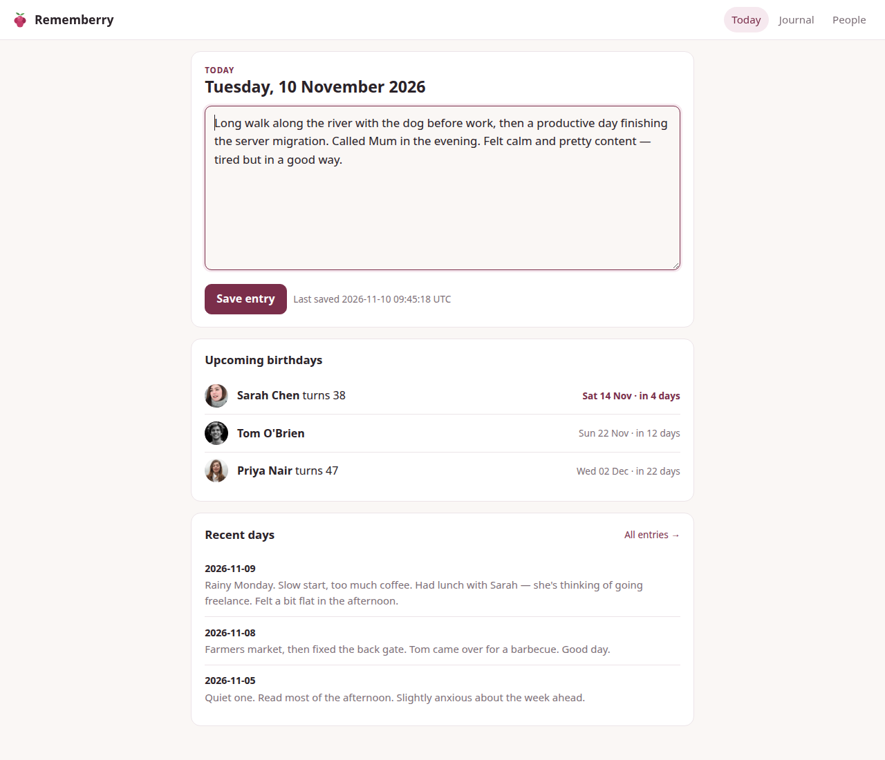

# Rememberry

A small, self-hosted personal app with two things in it:

- **People**: a dossier per person with a photo, birthday, children, when/where you met, job/work and a big free-text notes field. List, search across every field, and see birthdays coming up in the next 30 days.
- **Journal**: one short entry per day. Today's entry is on the home page, with **On this day** entries from the same date in previous years; browse, search and edit past days.
- **Tags**: comma-separated tags/groups on each person (family, work, book club); filter the people list by tag.
- **Quick notes**: short dated notes on a person ("Started a new job", "Asked about Mia's recital"), newest first, next to the free-text fields.
- **Birthday reminders**: a daily background check sends one message for birthdays today and N days out to whichever of ntfy, Pushover, Discord or email you configure. The settings page (gear icon) shows what's configured and has a "Send test notification" button.
- **Moods and photos**: pick a mood emoji and attach one photo per journal day. The journal calendar shows each day's mood for the month.
- **Backup and export**: one-click zip of the database and photos, and a Markdown export of the journal, from the settings page.
- **Installable**: a web app manifest, icons and a service worker let you add it to your phone's home screen (see [Install on your phone](#install-on-your-phone)).
- **@mentions**: type `@` in a journal entry to pick a person (`@Sarah Chen`, or just `@Sarah` if no one else is called Sarah). Their page lists every day they were mentioned.

Single user, one container, one port, everything stored in `/data`.



## Stack

Python 3.12, FastAPI, Jinja2 server-rendered pages, SQLite (stdlib `sqlite3`), plain CSS. No JavaScript build, no external services.

## Data

Everything lives in the `/data` volume:

| Path | Contents |
| --- | --- |
| `/data/rememberry.db` | SQLite database (people + journal) |
| `/data/uploads/` | Uploaded photos |

Back up that folder and you have backed up everything. You can also grab a backup from the browser: **Settings → Download backup** gives a zip with a consistent copy of the database, every photo, and the journal as Markdown (`journal.md`); **Export journal** downloads just the Markdown. To restore a backup zip, stop the container, unzip it into the data folder (replacing `rememberry.db` and `uploads/`), and start it again.

### Upgrades

The database schema is versioned. On startup the app applies any pending migrations; before it touches an existing database it writes a copy next to it as `rememberry.db.v<old-version>-<timestamp>.bak`. Once you're happy the new version works you can delete those `.bak` files.

## Configuration

| Env var | Default | Purpose |
| --- | --- | --- |
| `APP_PASSWORD` | empty | If set, the app shows a login screen asking for this password. Empty means no login. |
| `TZ` | `UTC` | Timezone that decides what "today" is, e.g. `Australia/Sydney`. |
| `SECRET_KEY` | derived from password | Optional random string used to sign the login cookie. |
| `PORT` | `8080` | Port inside the container. |

### Birthday reminders

All optional. Set any channels you want; with none set, reminders are off. Once a day, from `REMINDER_HOUR` in `TZ`, the app sends one message listing birthdays that are today or exactly `REMINDER_DAYS_AHEAD` days away. If the container is down all of that day, that day's reminder is skipped.

| Env var | Default | Purpose |
| --- | --- | --- |
| `REMINDER_DAYS_AHEAD` | `3` | How many days ahead to warn (you also get a message on the day). |
| `REMINDER_HOUR` | `9` | Earliest hour (0-23, local `TZ`) to send the daily reminder. |
| `NTFY_URL` | `https://ntfy.sh` | ntfy server, or a full topic URL like `https://ntfy.example.com/birthdays`. |
| `NTFY_TOPIC` | empty | ntfy topic, appended to `NTFY_URL`. Set this or a full `NTFY_URL` to turn ntfy on. |
| `NTFY_TOKEN` | empty | Access token for a protected ntfy topic. |
| `PUSHOVER_TOKEN` | empty | Pushover application API token. |
| `PUSHOVER_USER` | empty | Pushover user (or group) key. |
| `DISCORD_WEBHOOK_URL` | empty | Discord channel webhook URL. |
| `SMTP_HOST` | empty | Mail server. Email is on when this and `SMTP_TO` are set. |
| `SMTP_PORT` | `587` (`465` for `ssl`) | Mail server port. |
| `SMTP_SECURITY` | `starttls` | `starttls`, `ssl`, or `none`. |
| `SMTP_USER` / `SMTP_PASSWORD` | empty | Login, if your server needs one. |
| `SMTP_FROM` | `SMTP_USER` | From address. |
| `SMTP_TO` | empty | Where to send reminders (comma-separate several). |

Birthdays are free text. Write them as `YYYY-MM-DD` (or `MM-DD` if you don't know the year) and they show up in "Upcoming birthdays" with the age they're turning; anything else is stored as-is.

## Run with Docker Compose

```bash
docker compose up -d --build
# open http://localhost:8080
```

Data goes to `./data`. Edit `TZ` and `APP_PASSWORD` in `docker-compose.yml`.

## Run locally without Docker

```bash
python3 -m venv .venv && . .venv/bin/activate
pip install -r requirements.txt
DATA_DIR=./data uvicorn app.main:app --reload --port 8080
```

## Unraid setup

### 1. Get the image onto the server

The image isn't on Docker Hub, so pick one:

- **Build on the Unraid box** (simplest). In the Unraid terminal:

  ```bash
  cd /mnt/user/appdata
  git clone https://github.com/matda59/rememberry.git rememberry-src
  cd rememberry-src && docker build -t rememberry:latest .
  ```

  To update later: `cd /mnt/user/appdata/rememberry-src && git pull && docker build -t rememberry:latest .`, then restart the container.

- **Use GitHub Container Registry.** The included workflow (`.github/workflows/docker.yml`) builds and pushes `ghcr.io/matda59/rememberry:latest` on every push to `main`. Because the repo is private the package is private too: either make the package public in GitHub's package settings, or run `docker login ghcr.io` on Unraid with a personal access token that has `read:packages`. Then use `ghcr.io/matda59/rememberry:latest` as the repository below.

- **Build elsewhere and copy it:** `docker build -t rememberry:latest . && docker save rememberry:latest | ssh root@tower docker load`.

### 2. Add the container

**Option A: template.** Copy `unraid/rememberry.xml` to `/boot/config/plugins/dockerMan/templates-user/my-rememberry.xml` on the flash drive, then go to **Docker → Add Container** and pick `rememberry` from the Template dropdown.

```bash
cp /mnt/user/appdata/rememberry-src/unraid/rememberry.xml /boot/config/plugins/dockerMan/templates-user/my-rememberry.xml
```

**Option B: by hand.** **Docker → Add Container**, Advanced View off, and fill in:

| Field | Value |
| --- | --- |
| Name | `rememberry` |
| Repository | `rememberry:latest` (or `ghcr.io/matda59/rememberry:latest`) |
| Network Type | `bridge` |
| WebUI | `http://[IP]:[PORT:8080]/` |
| **Add Port**: Container Port `8080`, Host Port | `8080` (or any free port) |
| **Add Path**: Container Path `/data`, Host Path | `/mnt/user/appdata/rememberry` |
| **Add Variable**: Key `TZ` | e.g. `Australia/Sydney` |
| **Add Variable**: Key `APP_PASSWORD` | your password, or leave empty |

Click **Apply**, then open `http://<unraid-ip>:8080`.

### 3. Back up

Include `/mnt/user/appdata/rememberry` in your appdata backup (e.g. the Appdata Backup plugin). It holds the database and all photos.

## Install on your phone

Rememberry is a Progressive Web App, so it can sit on your home screen and open full-screen like a native app. It shows a small "You're offline" page when your server is unreachable; it doesn't keep data on the phone.

**Browsers only offer installing over HTTPS (or on `localhost`).** On a plain `http://192.168.x.x:8080` LAN address you'll get at most a bookmark-style shortcut and no service worker. To install it properly, put it behind a reverse proxy with a certificate, for example SWAG or Nginx Proxy Manager on Unraid, Caddy, or Tailscale Serve (`tailscale serve --bg 8080` gives you `https://<machine>.<tailnet>.ts.net`). Then:

- **Android (Chrome):** open the HTTPS address, menu **⋮ → Install app** (or **Add to Home screen**).
- **iPhone/iPad (Safari):** open the HTTPS address, **Share → Add to Home Screen**.

If you use `APP_PASSWORD`, you'll log in once inside the installed app.

## Security notes

This is built for a home LAN. The optional password is a single shared secret with a long-lived cookie; if you expose the app to the internet, put it behind a reverse proxy with HTTPS (and ideally your existing SSO/VPN) rather than relying on it alone.
